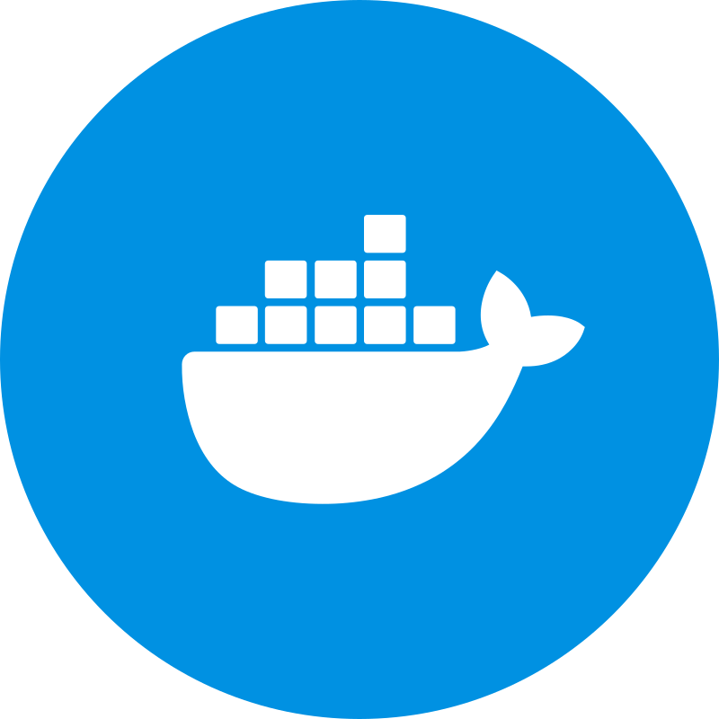
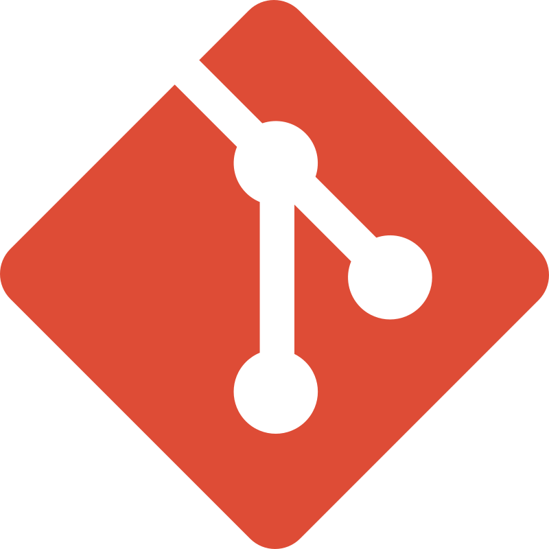

  <!-- Cursive Header: "Hello! I'm Mohith" -->
  
  

<h3 align="center">🧑‍💻 Whoami</h3>

  I'm a Generative AI Developer interested in building intelligent applications using Large Language Models (LLMs) and Retrieval-Augmented Generation (RAG). I work with Python, LangChain, FastAPI, and vector databases to develop practical AI solutions. I'm particularly interested in hybrid search, reranking, and agentic AI systems. I enjoy exploring new technologies and turning ideas into reliable, end-to-end applications.

  

---

### Tech Stack

> Tools, languages, and other things that I like to work with.

|  |  |  |  |  |  |
| :---: | :---: | :---: | :---: | :---: | :---: |
| Python | Java | LangChain | Gemini | Hugging Face | FastAPI |
|  |  |  |  |  |  |
| PostgreSQL | Supabase | React | Docker | Git | GitHub |

---

### 📊 GitHub Analytics

  

  

---

<h3 align="center">📫 Reach me on</h3>

  
  &nbsp;
  
  &nbsp;
  

---

  <b>💻 Check Out My Repos ⬇️</b>

---
